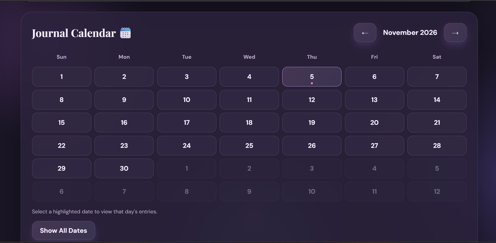

# 📔 Journal App

A full-stack Journal Application built using **Java, Spring Boot, Spring Security, and MongoDB**. It allows users to maintain personal journal entries, track their moods, organize memories, and view their journaling activity through an interactive dashboard.

## ✨ Features

- 🔐 User Registration and Login
- 📝 Create, Read, Update, and Delete Journal Entries
- 😊 Mood Tracking and Mood Analytics
- 🏷️ Categories and Tags Management
- 🔍 Search and Filter Journal Entries
- ⭐ Add Entries to Favorites
- 📅 Calendar View for Journal Entries
- 📊 Interactive Dashboard and Analytics
- 🌙 Light and Dark Mode

## 🛠️ Tech Stack

| Technology | Purpose |
|---|---|
| Java | Backend Programming |
| Spring Boot | Backend Framework |
| Spring Security | Authentication and Security |
| Spring Data MongoDB | Database Integration |
| MongoDB | NoSQL Database |
| HTML, CSS, JavaScript | Frontend |
| Maven | Dependency Management |
| Postman | API Testing |
| Git & GitHub | Version Control |

## 📸 Screenshots

### 🔐 Login Page


### 🏠 Main Dashboard


### 📝 Journal Entries


### 📖 Individual Journal Entry


### 📊 Mood Analytics


### 📅 Calendar


### ⭐ Memories & Favorites


## ⚙️ Getting Started

### Prerequisites

- Java 21 or compatible Java version
- MongoDB installed and running
- Git

### Installation

1. Clone the repository:

   ```bash
   git clone https://github.com/KritikaaSinghh/journal-app.git
   ```

2. Open the project directory:

   ```bash
   cd journal-app
   ```

3. Make sure MongoDB is running locally.

4. Run the application using Maven Wrapper:

   **Windows:**
   ```bash
   .\mvnw.cmd spring-boot:run
   ```

   **Linux/macOS:**
   ```bash
   ./mvnw spring-boot:run
   ```

5. Open your browser:

   ```text
   http://localhost:8080
   ```

## 🔌 Database Configuration

The application uses MongoDB.

Default local configuration:

```properties
spring.data.mongodb.uri=mongodb://localhost:27017/journalDB
```

## 👩‍💻 Author

**Kritika Singh**

- GitHub: [KritikaaSinghh](https://github.com/KritikaaSinghh)
- Portfolio: [My Portfolio](https://kritikaasinghh.github.io/)

---

⭐ If you find this project interesting, consider giving it a star!
